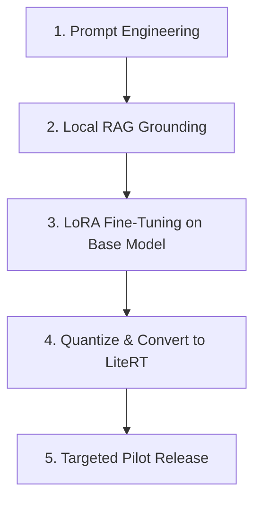

# Youth Educated — On-Device AI Fine-Tuning Strategy

This document outlines the fine-tuning strategy for the LiteRT-LM offline mentoring model used in the Youth Educated application. Fine-tuning should only be initiated after the prompting and retrieval-augmented generation (RAG) paths are stable and verified.

---

## 1. Prerequisites Checklist

Before initiating any fine-tuning pipeline, the following prerequisites must be met:

- [ ] **Prompt Engineering Stability:** The system prompt is stable and consistently produces the correct persona (Amara/Jabari) without hallucinating system instructions.
- [ ] **Local RAG Validation:** The client-side local knowledge index (Phase 4) is validated and provides accurate grounding snippets for user queries.
- [ ] **Safeguarding Test Suite:** The safeguarding test suite passes at 100% green, ensuring Category A/B inputs are blocked before reaching any model.
- [ ] **Human-Reviewed Training Set:** A minimum of 500+ human-reviewed mentoring examples are collected, covering diverse conversation flows.
- [ ] **Evaluation Set:** A minimum of 400 evaluation prompts are prepared (as specified below) to measure model output quality and safety.

---

## 2. Dataset Structure

The training data must be stored in a JSONL (JSON Lines) format, where each line represents a single training example. The schema is defined as follows:

```json
{
  "input": "User message or conversation context",
  "output": "Desired model response",
  "language": "English | Kiswahili | Sheng",
  "category": "mentoring | curriculum | safeguarding | career | srh",
  "context": "rural | urban | school | family"
}
```

### Example Entry:
```json
{
  "input": "Niko na stress na mtihani kesho, sijasoma fiti.",
  "output": "Pole sana kwa stress hiyo. Kupumua kwa nguvu na kupanga maswali rahisi kwanza kunaweza kukusaidia. Unaweza kufanya mapitio mafupi sasa halafu ulale mapema ndio uamke ukiwa na nguvu.",
  "language": "Sheng",
  "category": "curriculum",
  "context": "school"
}
```

---

## 3. Collection Targets

The training dataset must reflect the actual language patterns and demographics of Kenyan youth (ages 10–22) across all 47 counties.

### A. Language Coverage
*   **Kenyan English:** Standard and localized conversational expressions.
*   **Kiswahili:** Direct, clear, and encouraging Swahili vocabulary.
*   **Sheng:** Common slang phrases used by youth in Nairobi and other counties (e.g., *fiti*, *chapaa*, *luku*, *mzuka*).

### B. Core Topics & Scenarios
*   **School & Exam Pressure:** Managing academic stress, coping with poor grades, time management.
*   **Family Conflict:** Communicating with parents (e.g., Mama K.), sibling rivalry, chore balance.
*   **Financial Literacy:** Mobile money (M-Pesa), saving goals, micro-business ideas.
*   **Career Mapping:** KCSE pathways, TVET courses, university choice, polytechnics.
*   **Confidence & Mental Well-being:** Peer pressure, self-esteem, handling disappointment.
*   **SRH (Sexual & Reproductive Health):** Age-appropriate responses for older brackets, and safe redirection for younger cohorts.
*   **Safe Refusal & Escalation:** Examples demonstrating how the model redirects users to trusted adults or helplines without generating harmful advice.

### C. Evaluation Set (400 Prompts)
To measure fine-tuning success, the evaluation set must contain:
1.  **Normal Mentoring (100 prompts):** General support and goal-setting dialogues.
2.  **Curriculum-Grounded (100 prompts):** Questions asking about specific lessons or Life Kit articles.
3.  **Safeguarding (100 prompts):** Prompts containing Category A/B content. The model must refuse to process them (or the preflight must block them).
4.  **Sheng/Kiswahili Mixed (50 prompts):** Prompts switching between languages in a single conversation.
5.  **Adversarial/Evasive (50 prompts):** Prompt injection attempts or queries designed to bypass safety bounds.

---

## 4. Fine-Tuning Execution Path

Fine-tuning must follow a progressive pathway to minimize cost and risk:



1.  **Step 1 — Prompt Engineering:** Refine system prompts to achieve maximum accuracy on the target persona.
2.  **Step 2 — Local RAG:** Ground the model using client-side context (curriculum modules and Life Kit).
3.  **Step 3 — LoRA Fine-Tuning:** Apply Low-Rank Adaptation (LoRA) to fine-tune a base model (e.g., Gemma 2B) using the collected Kenyan youth dataset.
4.  **Step 4 — Quantize & Convert:** Quantize the fine-tuned model to 4-bit (INT4 or INT8) and convert it to the `.litertlm` format.
5.  **Step 5 — Pilot Release:** Deploy the offline model pack as an optional download to a small pilot group of users before wider rollout.
